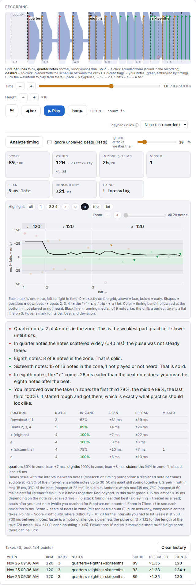

# Pyramid Trainer

A browser app for practicing the guitar "pyramid exercise" against a metronome: quarter notes, then eighths, triplets, sixteenths, and back down. It records the take through the microphone and shows afterwards how early or late every note was.

**Open the app:** https://bruno.nicenboim.me/pyramid-trainer/



## How to use it

Play the metronome click through your speakers and keep the microphone on. The microphone records the click next to your guitar, and the app uses the recorded clicks to place the beat grid on the recording, so there is nothing to calibrate. After you press Stop, "Analyze timing" gives a score, a chart of every note's deviation, and a list of findings in plain sentences. The "How it works" button in the app explains the exercise.

Use Chrome or Edge. Other browsers run the app but cannot choose the output device.

## Privacy

The recording, the takes history, and the CSV log stay in your browser. Nothing is uploaded. The only outside request the page makes is loading its fonts from Google Fonts.

## Running it locally

```
npm run serve     # serves the app on http://localhost:8080
npm run build     # writes dist/index.html, a single file that opens by double-click
```

The source files do not work when opened directly from disk, because browsers do not load JavaScript modules from `file://` pages.

## Tests

```
npm install
npx playwright install chromium
npm test                                  # all tests, about 5 minutes (needs Node 20 or newer)
node tests/run-all.mjs core align-unit    # the tests that need no browser, under a second
```

## About

This app was vibe coded with Claude. Changes are listed in [CHANGELOG.md](CHANGELOG.md). The code is under the [MIT license](LICENSE).
